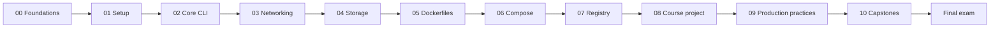

<div align="center">

# 🐳 Docker Mastery

**A hands-on, practice-first path from "what's a container?" to shipping secured images through CI.**


[Public learning site](https://markkaruga254.github.io/learn-docker/) · [Start here](#-start-here) · [Curriculum](#-curriculum) · [Capstones](#-capstones) · [Cheat sheets](cheatsheets) · [Final exam](assessment/final-exam.md)

</div>

---

A practice-first companion to the freeCodeCamp video
**[Learn Docker – Full DevOps Course for Deploying Containerized Apps](https://youtu.be/rjjES5IsPdg)** (DolfinEd, ~6h20m).

The video teaches the fundamentals. This repo turns them into **deliberate practice**: labs you type yourself,
break-and-fix exercises, assignments, quizzes, three tiered capstones and a final practical exam. It also adds a
**production-practices module** (multi-stage builds, non-root users, scanning, CI/CD), because the video stops at the
basics and a job-ready Docker skillset needs more.

> Not affiliated with freeCodeCamp or DolfinEd. All labs, exercises and text here are original and follow the
> video's chapter order. Watch the video for the instructor's walkthroughs.

## 🎯 What you'll be able to do

- Explain containers vs VMs and the Docker architecture without notes
- Run, inspect, debug and clean up containers confidently from the CLI
- Connect containers with networks and persist data with volumes (and back it up)
- Write efficient Dockerfiles and explain layers and caching
- Define multi-service apps with Docker Compose
- Publish images with a sensible tagging strategy and deploy from a registry
- Harden images (non-root, minimal, scanned, no secrets) and build them in CI
- Troubleshoot a broken stack under time pressure

## 🚀 Start here

1. **Fork and clone** this repo: `git clone https://github.com/Markkaruga254/learn-docker.git`
2. **Get a Docker host.** AWS EC2 is recommended ([Module 01](modules/01-environment-setup)); Docker Desktop or a local Ubuntu VM also works.
3. Run `scripts/doctor.sh` to check your environment.
4. Open [ROADMAP.md](ROADMAP.md) and start **Module 00**. Tick modules off as you go.
5. Read [CORRECTIONS.md](CORRECTIONS.md) once: it explains where this repo deliberately differs from the video.

### The loop for every module
```
watch the video chapter → read the module README → type the labs (no copy-paste)
→ do the assignments → take the quiz closed-book → check solutions.md → tick the roadmap
```
Predict output *before* you press Enter and write down every surprise. That's where the learning is.

## 🗺️ Curriculum



| # | Module | Video | You'll practise | Time |
|---|--------|-------|-----------------|------|
| 00 | [Foundations](modules/00-foundations) | 0:00 to 0:53 | VMs vs containers, namespaces, architecture | 3 h |
| 01 | [Environment setup](modules/01-environment-setup) | 0:53 to 1:42 | Safe AWS EC2 setup, installing Docker | 3 h |
| 02 | [Core CLI](modules/02-core-cli) | 1:42 to 2:08 | Lifecycle, exec, logs, inspect, 25-command drill | 4 h |
| 03 | [Networking](modules/03-networking) | 2:08 to 2:38 | Bridge, NAT, DNS by name, isolation | 4 h |
| 04 | [Storage](modules/04-storage) | 2:38 to 3:04 | Volumes, bind mounts, backup/restore | 4 h |
| 05 | [Dockerfiles](modules/05-dockerfiles) | 3:22 to 4:36 | Layers, caching, size challenge, CMD vs ENTRYPOINT | 6 h |
| 06 | [Compose](modules/06-compose) | 3:04, 4:36 | Multi-service stacks, healthchecks | 5 h |
| 07 | [Registry](modules/07-registry) | 4:54 to 5:12 | Tags, digests, Docker Hub, GHCR | 3 h |
| 08 | [Course project](modules/08-course-project) | 5:12 to 6:20 | Containerize and deploy a website | 3 h |
| 09 | [Production practices](modules/09-production-practices) | not in video | Multi-stage, non-root, secrets, Trivy, CI | 8 h |
| 10 | [Capstones](modules/10-capstones) | n/a | Three graded projects | 15 h |

Each module contains: `README.md` (objectives and concepts) · `labs.md` · `assignments.md` · `quiz.md` · `solutions.md`.

## 🏗️ Capstones

| Tier | Project | Proves |
|---|---|---|
| 1 | [Static site → registry → live](modules/10-capstones/tier1-static-site) | Dockerfile, ports, registry, clean-host deploy |
| 2 | [API + database + reverse proxy](modules/10-capstones/tier2-api-db-proxy) | Compose, networks, volumes, healthchecks, secrets |
| 3 | [Secured image + CI + deploy](modules/10-capstones/tier3-secure-pipeline) | Hardening, scanning, GitHub Actions, rollback |

Graded with a shared 100-point rubric (pass: 75). Reference solutions exist for Tiers 2 and 3. Try first.

## ✅ Prove it

- [Final exam](assessment/final-exam.md): written, command-writing, a **broken stack to debug**, and a build task. Pass at 80.
- [Confidence matrix](CONFIDENCE-MATRIX.md): rate yourself 0 to 3 on 20 skills and link your evidence.
- Add your capstone links to your fork's README so others can see what you built.

## 📚 Quick references

[Docker CLI](cheatsheets/docker-cli.md) · [Dockerfile](cheatsheets/dockerfile.md) · [Compose](cheatsheets/compose.md) · [Networking & storage](cheatsheets/networking-storage.md) · [Troubleshooting](cheatsheets/troubleshooting.md)

## ⚠️ Ground rules

- **Cost safety:** set an AWS billing alert first and *stop your instance when you finish*.
- **Never put secrets in images, Dockerfiles or Git.** Module 09 shows the right way.
- **Clean up** between modules with `scripts/cleanup.sh`.
- Labs were written against Docker Engine on Ubuntu 24.04. If something behaves differently for you, please open an issue or a PR.

## 🗂️ Repo layout

```
modules/NN-name/   README.md  labs.md  assignments.md  quiz.md  solutions.md  (+ starter/ files)
cheatsheets/       one-page references
assessment/        final exam + broken-stack debugging challenge
scripts/           doctor.sh (environment check), cleanup.sh (safe cleanup)
CORRECTIONS.md     fixes and caveats vs. the video
ROADMAP.md         schedule and progress checklist
```

## 🤝 Contributing

Found a typo, an outdated command, or a better lab? Open an issue or PR. Please keep labs runnable on a fresh
Ubuntu 24.04 host, include expected output where it helps, and never add secrets.

## 🙏 Credits

Course video by **DolfinEd** via **freeCodeCamp.org**. Learning material in this repo is original; add your preferred
license (e.g. MIT for code, CC BY 4.0 for text) in a `LICENSE` file before publishing.
